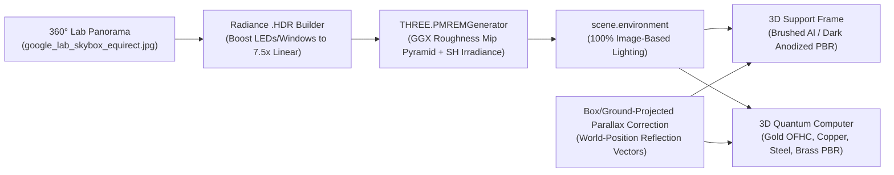

# Strategy & Technical Guide: Building the Cryostat Support Frame, Picture-Driven IBL Reflections, and 360° Background Anchoring

This guide synthesizes findings from our two previous technical analyses—**[LAB_BACKGROUND_ENVIRONMENT_GUIDE.md](file:///home/anna/quantum_experiment/LAB_BACKGROUND_ENVIRONMENT_GUIDE.md)** and **[QUANTUM_COMPUTER_MODEL_GUIDE.md](file:///home/anna/quantum_experiment/QUANTUM_COMPUTER_MODEL_GUIDE.md)**—along with industry best practices in Three.js and Babylon.js (`GroundedSkybox` / `GroundProjectedEnv`, Parallax-Corrected Cubemaps, and Shadow/Reflection Catchers).

It answers three core engineering questions:
1. **Should the structural frame holding the quantum computer be part of the 2D/360° background picture, or a 3D model like the quantum computer itself?**
2. **How do you drive realistic metallic reflections from the 360° background picture onto both the frame and the quantum computer?**
3. **How do you physically anchor the 3D frame and quantum computer into the 360° picture so that rotating 360° around the scene feels completely uniform, solid, and free of floating/sliding artifacts?**

---

## Part 1: Picture vs. 3D Model — Which Strategy Is Better for the Support Frame?

### Verdict: **The Support Frame MUST Be a 3D Model (Not Baked into the 360° Picture)**

While the **distant laboratory room** (walls, perimeter 19-inch RF racks, optical benches, windows, and ceiling cable trays at $r \approx 6\text{m}–15\text{m}$) works best as a **360° Skybox**, the **structural gantry frame** that holds the quantum computer sits at $r \approx 0.65\text{m}–0.95\text{m}$ from the center and physically bolts to the top of the cryostat.

Putting the support frame inside the 2D/360° background picture fails immediately when the user rotates or tilts the camera for four mathematical reasons:

| Criterion | Frame Baked into 2D/360° Picture (❌ Fails) | Frame Built as a 3D Model with Ground-Projected Anchoring (✅ Best Strategy) |
| :--- | :--- | :--- |
| **1. 3D Parallax During Orbit & Tilt** | Skybox pixels are projected at distance $R_{\text{sky}}$ with zero near-field parallax. When tilting the camera up/down or zooming, the 3D quantum computer moves in perspective while a picture frame stays glued to the background—causing the chandelier to **visibly slide off its mount**. | The 3D frame and 3D top flange (`plate_0` / 300 K plate) share the exact same 3D vertex transformations (`modelViewProjectionMatrix`). The joint between frame and cryostat is **100% rigid from every angle**. |
| **2. Depth Sorting & Front/Back Occlusion** | A skybox always renders behind 3D geometry (`depthWrite = false`). As you rotate $360^\circ$, the front two frame pillars can **never pass in front of** the quantum computer—breaking the 3D illusion every $90^\circ$. | The 4 vertical 3D frame posts write to the hardware depth buffer (`gl_FragDepth`). As you orbit $360^\circ$, near posts naturally occlude the chandelier and far posts pass behind it. |
| **3. Close-Up Inspection (`minDistance = 0.25m`)** | Zooming in on the top flange or HEMTs magnifies the background skybox pixels, making a 2D picture frame look blurry and flat next to sharp 3D coax cables. | Extruded aluminum T-slots, gusset plates, bolts, and pneumatic vibration isolators remain razor-sharp at any zoom level. |
| **4. Lighting & Self-Reflection** | A 2D picture frame cannot cast shadows onto the top plate or reflect the golden glow of the chandelier. | The 3D frame receives the exact same `.HDR` Image-Based Lighting (`scene.environment`) as the chandelier and casts contact AO where its feet touch the floor. |

> [!NOTE]
> **Why `apps.fz-juelich.de/qcmodel` Omitted the Frame in `qc_v15.gltf`:**  
> When inspecting `https://apps.fz-juelich.de/qcmodel/environment.js`, we found commented-out code referencing a `mounting` material (`let matMounting = materials.find(obj => obj.name === 'mounting')`) and a 3 MB `assets/textures/lightmap.png` still hosted on their server. Because the Jülich viewer used an **ungrounded spherical skybox** (`BABYLON.MeshBuilder.CreateBox("skyBox", {size: 150})` with no ground-plane projection), any 3D frame legs extending down to `y = 0` looked like they were floating in mid-air inside a sphere. Rather than implementing ground-projected skybox anchoring, they deleted the frame mesh and left the chandelier floating in the center of the bubble.  
> By combining a **3D Frame Model** with **Ground-Projected Skybox Anchoring** (detailed in Part 3 below), we get the best of both worlds: a physically supported quantum computer whose frame legs stand solidly on the 360° photograph's floor!

---

## Part 2: How to Add Reflections from the 360° Picture to the 3D Frame and Quantum Computer

In real life, a quantum computer and its anodized/brushed aluminum gantry frame look embedded in their laboratory because **every metallic highlight on their surfaces is a reflection of the room around them**:
- Looking at the vertical brushed-aluminum frame posts, you see elongated reflections of the room's bright ceiling LED panels, yellow/blue overhead helium trays, and dark perimeter RF racks.
- Looking at the horizontal gold-plated copper stage disks (`plate_0..4`), the top surfaces reflect the overhead ceiling trusses while the undersides reflect the grey ESD laboratory floor.

Here is the three-step pipeline to achieve this in Three.js:



### 2.1 Step 1: High-Dynamic-Range (HDR) Highlight Expansion + PMREM Convolution
A standard 8-bit JPEG skybox clamps bright ceiling lights and windows at `1.0` (`255`), which produces dull, grey reflections on metals with `metalness > 0.85`.
1. **Expand Light Sources into True HDR (`*_specular.hdr`)**:
   - As implemented in [`save_radiance_hdr()`](file:///home/anna/quantum_experiment/build_skybox_assets.py#L179-L219), convert the 360° sRGB panorama to linear light and apply a highlight expansion curve (`1.0 + 6.5 * highlight^2.6`) to pixels with luminance `> 0.62` (overhead LED troffers, observation windows, glowing oscilloscope screens).
2. **Convolve via `THREE.PMREMGenerator`**:
   - Pass the `.hdr` texture through `pmremGenerator.fromEquirectangular(hdrDataTex)`.
   - `PMREMGenerator` pre-integrates the picture into a pyramid of GGX specular mipmaps (for `roughness` from `0.0` mirror to `1.0` diffuse) plus 3-band Spherical Harmonics diffuse irradiance, and binds it to `scene.environment`.

### 2.2 Step 2: Material Roughness & Anisotropy Calibration for the Frame vs. Chandelier
To make the frame and quantum computer reflect the 360° picture naturally, each surface must sample the right mip level of `scene.environment`:

| Component | Material Type | `color` | `metalness` | `roughness` | `envMapIntensity` | Visual Reflection Behavior |
| :--- | :--- | :---: | :---: | :---: | :---: | :--- |
| **Google Lab Extruded T-Slot Frame** | Clear-Anodized Brushed Aluminum | `0xd8e0e8` | `0.88` | `0.26` | `1.20` | Crisp, slightly softened reflections of the room's colorful wall panels & ceiling trusses; vertical brush bump map elongates highlights along the posts. |
| **IBM Lab Heavy Gantry Frame** | Dark Matte Anodized Steel/Al | `0x1e242c` | `0.72` | `0.38` | `1.15` | Broad, high-contrast specular sheen catching the overhead LED strips and cyan rack glow without looking like chrome. |
| **Vibration Isolator Air Mounts** | Stainless Steel + EPDM Elastomer | `0xcfd6de` / `0x16191f` | `0.92` / `0.15` | `0.18` / `0.65` | `1.25` | Contrast between mirror-machined steel caps and matte black elastomer dampers. |
| **Chandelier Stage Disks (`plate_0..4`)** | Gold-Plated OFHC Copper | `0xffc438` | `0.95` | `0.16` | `1.28` | Warm, mirror-sharp gold reflections of the lab walls and floor. |

### 2.3 Step 3: World-Space Parallax-Corrected Reflection Vectors (Preventing "Infinite Sphere" Reflection Slip)
By default, Three.js samples `scene.environment` using only the pure view-reflection direction vector $\vec{R} = \text{reflect}(\vec{V}, \vec{N})$, assuming the environment map is infinitely far away.
- When a vertical gantry post is at $x = +0.9\text{m}$ and a gold plate is at $y = 0.5\text{m}$ above the floor, an infinite cubemap lookup doesn't account for the fact that the post is closer to the right wall or that the bottom plate is only $0.5\text{m}$ above the floor!
- **Solution — Sphere/Ground-Projected Reflection Vector Correction (`onBeforeCompile`)**:
  In the PBR fragment shader (`envmap_physical_pars_fragment`), intersect the reflection ray $\vec{P}_{\text{world}} + t\vec{R}_{\text{world}}$ with the finite laboratory room shell (radius $R_{\text{room}} = 15\text{m}$, floor plane $y = 0$, tripod height $H_{\text{cam}} = 1.65\text{m}$):

```glsl
// Parallax-corrected reflection direction matching the Ground-Projected Skybox
vec3 boxProjectedDirection(vec3 worldNormal, vec3 viewDir, vec3 worldPos, float roomRadius, float camHeight) {
    vec3 reflDir = reflect(-viewDir, worldNormal);
    vec3 tripodOrigin = vec3(0.0, camHeight, 0.0);

    // 1. Intersect reflection ray with room sphere of radius roomRadius
    vec3 oc = worldPos - tripodOrigin;
    float b = dot(oc, reflDir);
    float c = dot(oc, oc) - roomRadius * roomRadius;
    float tSphere = -b + sqrt(max(0.0, b * b - c));
    vec3 hitPos = worldPos + reflDir * tSphere;

    // 2. If reflection ray points downward and hits below y = 0, intersect with flat floor at y = 0
    if (hitPos.y < 0.0 && reflDir.y < -0.001) {
        float tFloor = -worldPos.y / reflDir.y;
        if (tFloor > 0.0) {
            vec3 floorHit = worldPos + reflDir * tFloor;
            float blend = smoothstep(roomRadius * 0.95, roomRadius * 0.65, length(floorHit.xz));
            hitPos = mix(hitPos, floorHit, blend);
        }
    }

    // 3. Return corrected lookup direction from the panorama tripod origin
    return normalize(hitPos - tripodOrigin);
}
```
Because the reflection ray now intersects the **exact same `y = 0` floor plane and `R = 15m` room dome** as the background skybox shader, the reflections on the frame legs and lower gold plates match the adjacent floor pixels seamlessly!

---

## Part 3: How to Anchor the 3D Frame & Computer into the 360° Picture (So Rotating 360° Is Completely Uniform)

When a user drags the mouse to rotate 360° around the quantum computer, why do some 3D models look like they are "floating in front of a wallpaper," while a properly anchored model looks physically bolted to the room floor?

To make the 3D frame and quantum computer rotate in **100% uniform lockstep** with the 360° background picture, five geometric and lighting anchors must work together:

```mermaid
flowchart TD
    subgraph W["1. Shared World-Space Coordinate Lock"]
        A1["360° Skybox Fixed to World Axes (+X, +Y, +Z)"]
        A2["3D Frame & Chandelier Fixed to World Origin (0, 0, 0)"]
        A3["Only the Camera Orbits — Frame Posts Stay Aligned with Same Lab Walls"]
        A1 --- A2 --- A3
    end

    subgraph G["2. Ground-Projected Floor Plane at y = 0"]
        G1["Lower Hemisphere of 360° Picture Projected onto Flat Plane y = 0"]
        G2["4 Gantry Feet Planted at (±0.88m, 0.0m, ±0.88m)"]
        G3["1:1 Perspective Parallax Between 3D Feet and Picture Floor Tiles"]
        G1 --> G2 --> G3
    end

    subgraph C["3. Visual Contact & Floor Integration at y = 0"]
        C1["Soft Radial Contact Ambient Occlusion Under All 4 Feet & Center Cryostat"]
        C2["Directional Floor Shadow Catcher Matched to Ceiling LED Key Light"]
        C3["Subtle Floor Specular Reflection Catcher (8–12% Opacity Bounce)"]
        C1 --- C2 --- C3
    end
```



### 3.1 Anchor 1: World-Space Orientation Lock (Never Rotate the Model Against the Skybox)
- **Rule**: Never implement "turntable rotation" by rotating `quantumComputer.rotation.y` while keeping the skybox stationary (or vice versa). If the 3D model rotates while the skybox stands still, the frame legs will slide across the floor and the reflections won't move with the room.
- **Correct Implementation**:
  - Both the **360° Skybox**, the **3D Support Frame**, and the **3D Quantum Computer** remain permanently fixed in World Space (`rotation = (0, 0, 0)`).
  - Rotation is performed exclusively by orbiting `camera.position` around `controls.target` (`OrbitControls`).
  - Furthermore, align the 4 gantry posts (`(±0.88, 0, ±0.88)`) parallel to the architectural axes (`+X` and `+Z`) of the 360° panorama so the square gantry frame sits parallel to the perimeter RF racks and optical tables in the photograph!

### 3.2 Anchor 2: Ground-Projected 360° Skybox (`y = 0` Floor Flatten Shader)
In a standard spherical or cubemap skybox, every pixel of the floor is rendered on a sphere far below `y = 0`. If you place a 3D frame foot at `(0.88, 0, 0.88)` and tilt the camera, the foot moves horizontally across the screen faster than the distant spherical floor behind it—creating **parallax sliding** ("ice-skating feet").
- **How Ground Projection Solves This Completely**:
  - In our `GroundProjectedSkyboxShader` (see [`initSkyboxMeshes()`](file:///home/anna/quantum_experiment/js/environment.js#L114-L194) in `js/environment.js`), any viewing ray $\vec{P}_{\text{cam}} + t\vec{D}$ that looks downward at the floor intersects the **mathematical horizontal plane $y = 0$** at:
    $$t_{\text{floor}} = -\frac{P_{\text{cam},y}}{D_y}, \qquad \vec{X}_{\text{floor}} = \vec{P}_{\text{cam}} + t_{\text{floor}}\vec{D}$$
  - Because $\vec{X}_{\text{floor}}$ lies at $y = 0.000$ in 3D World Space—and the bottom of each 3D frame foot *also* lies at $y = 0.000$ in 3D World Space—both the 3D foot vertex and the skybox floor pixel immediately underneath it undergo the **exact same perspective projection** (`projectionMatrix * viewMatrix * vec4(X_floor, 1.0)`).
  - **Result**: Whether you orbit $360^\circ$, tilt from ceiling to floor, zoom in to $0.5\text{m}$, or pan sideways, the 3D frame feet stay **100% locked to the exact same millimeter of the photograph's floor** with zero sliding!

### 3.3 Anchor 3: Multi-Scale Contact Ambient Occlusion & Shadow Catcher at `y = 0`
Even when a 3D post is mathematically locked to `y = 0`, the human eye only perceives an object as "touching the ground" if the ground becomes darker and less reflective immediately underneath it:
1. **Tight Crevice Contact AO under Each Gantry Foot (`R = 0.22m`)**:
   - Place a soft radial darkening decal (`y = 0.001`) directly under each of the 4 leveling pads at `(±0.88, 0, ±0.88)` with `opacity = 0.72` at the bolt pad center fading to `0.0` over `22 cm`.
2. **Broad Central Cryostat & Gantry Floor Ambient Occlusion (`R = 1.35m`)**:
   - Place a wide, subtle ambient shadow mat (`y = 0.0005`, `opacity = 0.22`) across the footprint of the gantry frame (`-0.95m` to `+0.95m`), simulating how the overhead 300 K top deck and chandelier plates block overhead ceiling light from reaching the center of the floor.
3. **Perimeter Beam Floor Projection**:
   - Faint soft linear AO strips along the 4 perimeter lines connecting the gantry feet ground the entire square footprint into the light-grey ESD floor.

### 3.4 Anchor 4: Floor Specular Reflection Catcher (Reflecting the 3D Frame & Chandelier IN the Picture's Floor)
Look at the floor in our Google Quantum AI and IBM Cleanroom 360° panoramas: it is a semi-glossy anti-static epoxy/tile floor (`roughness ≈ 0.25–0.35`) that visibly reflects the racks and ceiling lights in the background photo.
- If the floor reflects the 2D racks in the photo, **it should also subtly reflect the 3D frame legs and golden chandelier standing in the center!**
- **Lightweight Real-Time Technique (Floor Reflection / Bounce Disc at `y = 0.0015`)**:
  - Add a radial floor-reflection shader plane at `y = 0.0015` under the gantry and chandelier that projects a vertically inverted, distance-blurred specular reflection (or Fresnel-weighted metallic gold/aluminum bounce tint) onto the floor:
    - Directly beneath the 4 vertical aluminum frame legs (`(±0.88, 0, ±0.88)`), it casts a soft vertically-stretched silver-grey reflection streak into the floor (`alpha ≈ 0.12`, fading exponentially with distance from `y = 0`).
    - Directly beneath the bottom of the golden chandelier (`r < 0.45m`), it casts a subtle warm golden specular reflection glow (`0xffc438`, `alpha ≈ 0.08 * fresnel`) onto the grey floor directly under the QPU!

### 3.5 Anchor 5: Calibrating Camera Tripod Height (`uHeight`) & Orbit Target
Finally, for the 3D frame's vertical proportions to match the perspective of the 19-inch racks and optical tables in the 360° picture:
1. **Match `uHeight` to the Panorama Camera Height (`1.65m`)**:
   - The 360° laboratory panoramas were captured from human eye level (`H_cam = 1.65m`). Setting `uHeight = 1.65` in the Ground-Projected Skybox shader ensures the horizon line ($v = 0.5$) sits at $y = 1.65\text{m}$—matching the height of the 19-inch racks (`2.0m` tall) and optical tables (`0.9m` tall).
2. **Match the 3D Frame Dimensions to Real Cleanroom Hardware**:
   - Total Gantry Height: **`2.42m`** (from `y = 0.00m` floor leveling feet up to the `y = 2.34m` top deck supporting the `300 K / 50 K` top flange of the quantum computer).
   - Gantry Footprint Width × Depth: **`1.76m × 1.76m`** (`posts at X = ±0.88m, Z = ±0.88m`), giving ample clearance around the `Ø 0.90m` chandelier and `Ø 1.02m` outer vacuum hull while leaving wide sightlines to the quantum computer from every angle.
   - Enable **Ground-Projected Skybox mode** whenever the 3D floor-standing frame is active so `y = 0` is a true flat perspective plane!

---

## Part 4: Extending the Cryostat & Frame to Room-Temperature Wiring, RF-DAC Control Racks, and Gas Handling

When extending the quantum computer model beyond the 300 K top vacuum flange (`plaque`) to include **the wiring that comes out of it and the room-temperature equipment those cables plug into**, the exact same 3D parallax, IBL reflection, and `y = 0` floor-anchoring rules apply:

1. **Why the Connected Control Rack & Gas Handling Cabinet Must Also Be 3D Geometry**:
   - If 3D coaxial cable bundles (`room_temp_wiring`) exit the top of the 3D cryostat (`top_breakout_manifolds`) and try to terminate onto a 2D rack painted into the distant 360° skybox wallpaper, rotating the camera even $5^\circ$ causes the 3D cable ends to rip away from the 2D picture!
   - By modeling the **Extended T-Slot Gantry Wings & Overhead Cable Trays** (`X = ±0.86m → ±1.76m`), the **19-Inch Google Quantum AI RF-DAC/FPGA Control Electronics Rack** (`X = +1.42m, y = 0..2.18m`), and the **Bluefors ³He/⁴He Gas Handling & Compressor Cabinet** (`X = -1.42m, y = 0..2.12m`) in 3D World Space, every coaxial cable and helium flex line remains 100% physically connected from the chandelier all the way into the rack SMA ports from every 360° angle.

2. **Hardware Architecture Modeled from Google Quantum AI References (`sci_news_14467_quantum_computer.jpg`, `Dilution_Fridge_009_8K.png`, `Google_Quantum_AI_Cryostat.jpg`)**:
   - **`top_breakout_manifolds` (`seq: 22`)**: 8 radial CNC-milled finned aluminum hermetic coaxial feedthrough towers mounted on top of the 300 K flange directly above the 8 internal coaxial pods, plus 4 multi-pin Fischer/Lemo DC & thermometry turrets.
   - **`room_temp_wiring` (`seq: 23`)**: 168+ color-coded room-temperature coaxial cables (**Emerald-Green** XY qubit drive, **Royal-Blue** Z flux-bias & tunable couplers, **Amber-Yellow** readout & pump, and **Silver-White** clock/DC looms) rising from the 8 hermetic towers, crossing the `+X` overhead perforated ladder cable tray, and hanging in catenary loops bound with **black Velcro straps** directly into the front SMA panels of the control crates.
   - **`control_electronics_rack` (`seq: 24`)**: Floor-standing 19-inch matte-black instrumentation rack at `X = +1.42m` containing **4 stacked 6U Google Custom RF-DAC/FPGA/ADC Subracks** (each with 12 blue-faced modular Eurocard blades, protruding white top/bottom card-ejector latches, and dual columns of gold SMA jacks) plus a **Master 10 MHz Rubidium Clock & LO Synthesizer** and **Low-Noise Linear PDU**.
   - **`pulse_tube_assembly` (`seq: 25`)**: Twin Cryomech PT415/PT420 Pulse-Tube Cryocooler Cold Heads on the `-X` top deck with stacked copper cooling fins, anodized blue rotary valve stepper motors, and 4 braided stainless-steel high-pressure helium flex hoses.
   - **`gas_handling_system` (`seq: 26`)**: Central 300 K stainless turbo-molecular pump & KF-50 vacuum manifold tee, 3 overhead stainless `³He/⁴He` circulation pipes, and the floor-standing **Bluefors Gas Handling & Cryo-Compressor Cabinet** at `X = -1.42m` with a P&ID dilution mimic panel, dual high/low pressure gauges, and twin lower `³He/⁴He` dump cylinders.

