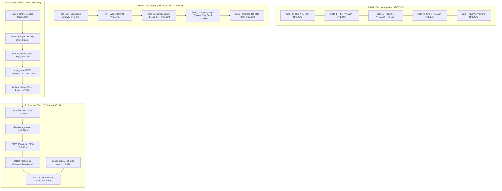

# Complete Technical Guide: How `apps.fz-juelich.de/qcmodel` Builds Its Quantum Computer (and How to Recreate It)

Reference analyzed: **`https://apps.fz-juelich.de/qcmodel/`**  
(*Interactive 3D Superconducting Quantum Computer Model — Forschungszentrum Jülich, Peter Grünberg Institute (PGI), created by Sebastian Droege & Daniel Zeuch*).

---

## 1. High-Level Architecture Overview

When inspecting the live production files of `https://apps.fz-juelich.de/qcmodel/`, the quantum computer application is divided into four tightly integrated layers:

| Layer | Source Files | Responsibility |
| :--- | :--- | :--- |
| **1. Chandelier 3D Geometry & PBR Atlas** | `assets/model/qc_v15.gltf`, `qc_v15.bin`, `textures/combined_4k_{BC,ORM,N}` | 38 separate named mesh nodes (`268,966` vertices total) sharing a **single 4K PBR material atlas (`qcCombined`)** with baked Ambient Occlusion (`UV1`). |
| **2. Outer Vacuum Hull (Cryostat Can)** | `assets/hull/hull.gltf`, `hull.bin`, `textures/hull_{BC,ORM,N}.jpg` | 1 cylindrical thermal/vacuum shield mesh (`8,969` vertices) appended asynchronously and toggled only when the **"Hull"** mode is selected. |
| **3. 100% IBL Lighting & Skybox** | `environment.js`, `room2_skybox.dds`, `room2_specular.env` | Disposes all analytic lights (`scene.lights[0].dispose()`) and illuminates the gold, copper, steel, and brass purely via prefiltered HDR Image-Based Lighting (`environmentIntensity = 1.2`). |
| **4. Subsystem Modes, Guided Tour & Camera Fly-To** | `objectInteraction.js`, `assets/configs/textfields.json`, `nametagsPositions.json`, `assets/lang/en_US.xml` | Groups parts into 4 color-coded functional modes, renders 3D-anchored nametags, pulses a glow outline (`HighlightLayer`), and animates the camera across 22 sequential tour stops (`seq: 0..21`). |

---

## 2. Exact 3D Scene Graph & Coordinate Blueprint (`qc_v15.gltf` + `hull.gltf`)

The reference model uses a vertical coordinate system where the quantum computer chandelier hangs downward from **`Y = 5.83`** (top developer plaque / 50K flange) down to **`Y = 0.51`** (TWPA & QPU at the bottom below the 10 mK stage).

> [!IMPORTANT]
> **Coordinate Convention Note (`coordsSwitchYZ`):**  
> In `qc_v15.gltf` (exported from Blender with `Khronos glTF Blender I/O v3.2.43`), **`+Y` is Up** in the 3D scene, whereas `nametagsPositions.json` stores raw Blender `(X, Y, Z)` coordinates where **`+Z` was Up**. In `objectInteraction.js`, `coordsSwitchYZ(vec)` swaps `Y` and `Z` (`new Vector3(x, z, y)`) when reading `nametagsPositions.json`.

### 2.1 Complete Table of All 38 Mesh Nodes in `qc_v15.gltf` (+ `hull.gltf`)

Every interactive and structural part of the quantum computer is a distinct named mesh node so it can be individually picked, highlighted, and tagged:

#### A. The 5 Cryogenic Stage Plates (`mode: "plates"`, Highlight Color: `#FCE94F` Yellow)

Unlike some diagrams that include the 300 K room-temperature top flange as Plate 0, the Jülich model numbers its five gold-plated copper disks from **`plate_0` (~50 K)** down to **`plate_4` (10 mK)**:

| Node ID | Mesh Name | Stage Temperature | World `Y` Height | Radius (`X/Z` Half-Extent) | Thickness (`ΔY`) | Vertex Count | Key Geometry Details |
| :---: | :--- | :--- | :---: | :---: | :---: | :---: | :--- |
| `5` | **`plate_0`** | **~50 K (-223 °C)** | `5.783` | `1.250` (Ø `2.50`) | `0.050` | `656` | Topmost gold-plated disk; clean circular feedthrough holes. |
| `11` | **`plate_1`** | **~4 K (-269 °C)** | `4.915` | `1.240` (Ø `2.48`) | `0.109` | `39,214` | High-detail milled cutouts, circular ports, and perimeter bolt holes. |
| `10` | **`plate_2`** | **~800 mK (-272.35 °C)** | `3.496` | `1.155` (Ø `2.31`) | `0.091` | `37,898` | Still stage plate; houses the central Still pot and cable pass-throughs. |
| `9` | **`plate_3`** | **90 mK (-273.06 °C)** | `2.496` | `1.075` (Ø `2.15`) | `0.091` | `35,084` | Cold plate (intermediate stage between Still and Mixing Chamber). |
| `6` | **`plate_4`** | **10 mK (-273.14 °C)** | `1.494` | `1.000` (Ø `2.00`) | `0.106` | `71,176` | Mixing Chamber (MXC) plate; densest mesh with machined mounting holes. |

#### B. Central Helium-3 / Helium-4 Dilution Cooling Column (`mode: "helium_system"`, Highlight Color: `#729FCF` Blue)

The entire dilution refrigeration cycle runs straight down the central axis `(X ≈ 0, Z ≈ 0)` through the center of the plates:

| Node ID | Mesh Name | Tour `seq` | World Translation `(X, Y, Z)` | Local Bounding Box `(Min → Max)` | Vertex Count | Physical & Visual Description |
| :---: | :--- | :---: | :---: | :---: | :---: | :--- |
| `12` | **`gas_pipe`** | `16` | `(0.000, 5.036, 0.000)` | `[-0.22, -0.12, -0.22] → [0.22, 0.76, 0.22]` | `1,451` | Concentric vertical tube between `plate_0` (`5.78`) and `plate_1` (`4.91`) with a cutaway section showing the inner supply capillary inside the outer discharge pipe. |
| `13` | **`pipe_still`** | — | `(0.000, 3.739, 0.000)` | `[-0.22, 0.14, -0.22] → [0.22, 1.17, 0.22]` | `202` | Vertical stainless/copper column connecting `plate_1` (`4.91`) down into the top of the `still` at `3.88`. |
| `17` | **`still`** | `17` | `(0.000, 3.739, 0.000)` | `[-0.22, -0.25, -0.22] → [0.22, 0.14, 0.22]` | `1,504` | Cylindrical evaporation chamber (`Ø 0.448`, height `0.385`) straddling `plate_2` (`Y = 3.496`) where lighter He-3 evaporates (~800 mK). |
| `7` | **`heat_exchanger_round`** | `18` | `(-0.003, 2.778, 0.003)` | `[-0.22, -0.28, -0.23] → [0.23, 0.71, 0.22]` | `2,239` | **Continuous Heat Exchanger**: Coiled helical concentric capillary spiral (`Y = 3.49` down to `2.49`, between `plate_2` and `plate_3`) that precools incoming He-3 down to ~30 mK. |
| `14` | **`heat_exchanger_steps`** | `19` | `(0.000, 2.158, 0.000)` | `[-0.14, -0.31, -0.14] → [0.14, 0.33, 0.14]` | `874` | **Step Heat Exchanger**: Stack of 5 vertical disc-shaped sintered-metal chambers welded in series (`Y = 2.49` down to `1.84`, between `plate_3` and `plate_4`) with opposing twin capillary tubes. |
| `16` | **`mixing_chamber`** | `20` | `(0.000, 1.505, 0.000)` | `[-0.24, -0.08, -0.22] → [0.24, 0.34, 0.22]` | `3,214` | Cylindrical Mixing Chamber pot (`Ø 0.48`, height `0.42`) sitting immediately above `plate_4` (`Y = 1.494`) where He-3/He-4 phase separation reaches `< 10 mK`. |
| `15` | **`middle_staff`** | — | `(0.000, 1.505, 0.000)` | `[-0.06, -0.52, -0.06] → [0.06, -0.02, 0.06]` | `34` | Central cold-finger post extending downward (`Y = 1.48` down to `0.98`) from the underside of `plate_4` to support the QPU cold stage. |

#### C. Electronic Circuits: Control Lines, Readout Lines, Amplifiers & QPU (`mode: "electronic_circuit"`, Highlight Color: `#8AE234` Green)

Notice how the Jülich model organizes its microwave wiring into **two distinct sides** so the viewer can clearly distinguish **Input (Control)** from **Output (Readout/Measurement)**:
- **Right Side (`+X` side, `X ≈ +0.30` to `+0.82`)**: **Control Lines (`cables_control`)**, **Attenuators (`attenuators`)**, **Bandpass Filters (`filter_bandpass`)**, **Open Coaxial Cutaway (`open_cable`)**, and **Microwave Isolators (`isolator`)**.
- **Left Side (`-X` side, `X ≈ -0.30` to `-0.94`)**: **Measurement/Readout Lines (`cables_measuring`)**, **Directional Coupler (`directional_coupler`)**, **TWPA (`TWPA`)**, **HEMT Amplifiers (`HEMTS`)**, and **HEMT DC Power Supply Cables (`power_supply`)**.
- **Bottom Center (`X ≈ 0, Y ≈ 0.627`)**: **The Quantum Processor (`qpu`)** mounted inside its copper PCB carrier (`chip_plate_brown_low`) and magnetic shield (`bottom_cover_low`).

| Node ID | Mesh Name | Tour `seq` | World Translation `(X, Y, Z)` | Local Bounding Box `(Min → Max)` | Vertex Count | Component Engineering Details |
| :---: | :--- | :---: | :---: | :---: | :---: | :--- |
| `34` | **`cables_control`** | `4` | `(0.609, 2.997, 0.582)` | `[-0.51, -1.98, -0.69] → [0.19, 2.78, 0.06]` | `3,024` | Semi-rigid coaxial lines running down the `+X` side (`Y = 5.77` down to `1.02`) with characteristic **360° thermal-contraction strain-relief loops** between stages. |
| `33` | **`cables_measuring`** | `5` | `(-0.494, 2.921, 0.194)` | `[-0.31, -2.78, -0.73] → [1.11, 2.86, 0.46]` | `3,962` | Readout coaxial lines running down and back up the `-X` side (`Y = 5.78` down to `0.14`) connecting the QPU through the directional coupler, TWPA, and HEMTs. |
| `30` | **`HEMTS`** | `6` | `(-0.674, 4.471, -0.118)` | `[-0.22, -0.32, -0.19] → [0.18, 0.34, 0.17]` | `9,788` | High-Electron-Mobility Transistor low-noise amplifier modules mounted just below the 4 K plate (`plate_1`, `Y = 4.47`) on `mounting_plate_top_low`. |
| `31` | **`power_supply`** | `7` | `(0.002, 4.656, -0.489)` | `[-0.94, -0.24, -0.19] → [0.68, 1.12, 0.52]` | `4,344` | Multi-wire DC bias loom (`Y = 4.41` to `5.78`) supplying DC power from the top flange to the HEMT amplifiers at 4 K. |
| `3` | **`filter_bandpass`** | `8` | `(0.542, 1.748, 0.314)` | `[-0.22, -0.22, -0.09] → [0.22, 0.06, 0.09]` | `3,327` | Inline cylindrical microwave bandpass filters bolted to `plate_4` (`Y = 1.53` to `1.81`) on the `+X` control bank. |
| `37` | **`attenuators`** | `9` | `(0.542, 3.436, 0.314)` | `[-0.21, -1.10, -0.08] → [0.21, 1.44, 0.08]` | `1,512` | Inline SMA cryogenic attenuator blocks mounted across `plate_1` (`4.87`), `plate_2` (`3.49`), and `plate_3` (`2.33`) to thermalize the inner conductor of the control coax lines. |
| `35` | **`open_cable`** | `10` | `(0.718, 1.355, 0.270)` | `[-0.01, -0.20, -0.01] → [0.14, 0.00, 0.57]` | `262` | Educational cutaway coaxial line below `plate_4` exposing the inner center conductor, white PTFE (Teflon) dielectric cylinder, and outer metallic jacket. |
| `24` | **`qpu`** | `11` | `(0.003, 0.627, -0.001)` | `[-0.14, -0.14, -0.01] → [0.13, 0.12, 0.01]` | `1,294` | The superconducting Quantum Processing Unit chip die (`0.26 × 0.26`) mounted vertically at the bottom center (`Y = 0.627`) so its circuit pattern faces the camera directly! |
| `22` | **`isolator`** | `12` | `(0.624, 0.895, -0.495)` | `[-1.28, -0.25, -0.08] → [0.06, 0.50, 0.40]` | `11,363` | Rectangular/cylindrical magnetic microwave isolators suspended below `plate_4` (`Y = 0.65` to `1.39`) blocking thermal noise from traveling backward into the QPU. |
| `19` | **`directional_coupler`** | `13` | `(-0.434, 1.123, -0.546)` | `[-0.09, -0.28, -0.03] → [0.27, 0.28, 0.11]` | `3,528` | 4-port microwave directional coupler mounted on `mounting_plate_bottom_left_low` (`Y = 0.84` to `1.40`) routing readout pulses. |
| `20` | **`TWPA`** | `14` | `(-0.575, 0.517, -0.510)` | `[-0.15, -0.23, -0.07] → [0.15, 0.23, 0.07]` | `1,810` | Traveling-Wave Parametric Amplifier mounted at the bottom-left (`Y = 0.29` to `0.75`, 10 mK stage) for near-quantum-limited first-stage readout amplification. |

#### D. Structural Standoffs, Brackets, QPU Carrier & Hull (Non-Picked / Structural Meshes)

| Node ID | Mesh Name | World Translation `(X, Y, Z)` | Vertex Count | Purpose in the Chandelier Assembly |
| :---: | :--- | :---: | :---: | :--- |
| `8` | **`staffs_low`** | `(0, 0, 0)` | `408` | Vertical support rods (`Y = 1.49` to `5.78`, `R ≈ 1.05`) connecting all 5 stage plates (`plate_0` through `plate_4`). |
| `4` | **`bolts_staffs`** | `(0, 0, 0)` | `5,187` | Hex nuts and collar flanges securing the vertical support rods at each plate interface. |
| `0` | **`bolts_left`** | `(0, 0, 0)` | `16,944` | Detailed SMA hex nuts, bulkhead feedthrough collars, and bracket screws on the `-X` (measurement) side (`Y = 1.31` to `5.17`). |
| `1` | **`bolts_right`** | `(0, 0, 0)` | `20,292` | Detailed SMA hex nuts, bulkhead feedthrough collars, and attenuator screws on the `+X` (control) side (`Y = 1.35` to `5.13`). |
| `29` | **`mounting_plate_top_low`** | `(-0.583, 4.900, -0.277)` | `432` | Gold-plated vertical L-bracket hanging beneath `plate_1` (`4.90` down to `4.32`) that holds the `HEMTS`. |
| `18` | **`mounting_plate_bottom_left_low`** | `(-0.540, 1.483, -0.640)` | `368` | Vertical bracket hanging beneath `plate_4` (`1.48` down to `0.42`) holding `directional_coupler` and `TWPA`. |
| `21` | **`mounting_plate_bottom_right_low`** | `(0.637, 1.483, -0.531)` | `368` | Vertical bracket hanging beneath `plate_4` (`1.48` down to `0.68`) holding the `isolator` bank. |
| `27` | **`chip_plate_brown_low`** | `(0, 0, 0)` | `39,653` | Ornate copper/PCB octagonal QPU sample holder frame (`Y = 0.44` to `0.80`) surrounding the `qpu` die. |
| `26` | **`plastic adapter_low`** | `(0.000, 0.854, -0.012)` | `6,223` | Multi-port SMP/SMA connector block at the top of the QPU sample holder (`Y = 0.85` to `0.96`). |
| `28` | **`soldering_low`** | `(-0.149, 0.758, -0.010)` | `2,083` | Fine solder joints linking the coax launch pins into the QPU PCB fanout. |
| `32` | **`curves_chip_low`** | `(-0.148, 0.763, -0.010)` | `686` | Short semi-rigid coax launch pigtails curving from the `plastic adapter_low` into `soldering_low`. |
| `23` | **`bottom_cover_low`** | `(0, 0, 0)` | `1,196` | Half-cutaway cylindrical cryoperm/copper magnetic shield can (`Y = 0.29` to `0.99`, `R = 0.246`) around the QPU assembly so the viewer can see inside! |
| `25` | **`bottom_cover_staff_low`** | `(0, 0, 0)` | `860` | Vertical support rods (`Y = 0.31` to `0.98`) holding the cutaway QPU shield can to the underside of `plate_4`. |
| `2` | **`bolts_chip`** | `(0, 0, 0)` | `7,324` | Miniature precision screws around the QPU PCB frame and shield can (`Y = 0.45` to `1.17`). |
| `36` | **`plaque`** | `(0.000, 5.831, 0.000)` | `820` | Top circular cap / developer credits plaque (`seq: 21`, `mode: "single"`) sitting on top of `plate_0`. |
| `hull` | **`hull` (`hull.gltf`)** | `(0.000, 4.264, 0.000)` | `8,969` | Outer cylindrical vacuum vessel (`R = 1.585`, `Y = 0.00` to `5.90`), hidden by default (`hull.setEnabled(false)`) and shown only when `mode === 'hull'`. |

---

## 3. How the Materials & Textures Work (Single-Atlas PBR + Baked AO)

One of the smartest engineering decisions in `apps.fz-juelich.de/qcmodel` is how it achieves high frame rates despite having **268,966 vertices** and dozens of complex components:

### 3.1 The Unified `qcCombined` PBR Material
Instead of creating 20 separate materials that cause shader state switches, all 38 meshes in `qc_v15.gltf` use **Material `[0]` (`qcCombined`)**:
```json
{
  "doubleSided": true,
  "name": "qcCombined",
  "pbrMetallicRoughness": {
    "baseColorTexture": { "index": 1 },
    "roughnessFactor": 0.6,
    "metallicRoughnessTexture": { "index": 2 }
  },
  "occlusionTexture": {
    "index": 2,
    "texCoord": 1,
    "strength": 0.5
  },
  "normalTexture": { "index": 0 }
}
```
- **Why Two UV Sets (`TEXCOORD_0` and `TEXCOORD_1`) Are Used:**
  - `TEXCOORD_0` maps overlapping/tiled islands onto the 4K BaseColor (`combined_4k_BC.jpg`), Normal (`combined_4k_N.png`), and Roughness/Metallic (`G` and `B` channels of `combined_4k_ORM.jpg`).
  - `TEXCOORD_1` (`texCoord: 1`) is a **non-overlapping lightmap/AO UV unwrap** that reads the **Red (`R`) channel of `combined_4k_ORM.jpg`** (`occlusionTexture`, `strength: 0.5`).
  - This bakes **contact Ambient Occlusion** directly into the crevices where coax connectors, bolts, heat exchangers, and support rods meet the gold-plated plates—without requiring expensive runtime raytracing!

### 3.2 How to Recreate These Exact PBR Materials in Three.js (Procedural or Texture-Based)

When building this quantum computer in Three.js inside our 360° HDR IBL environment (`scene.environment = pmremTex`), `THREE.MeshStandardMaterial` / `THREE.MeshPhysicalMaterial` responds identically to the `.hdr` environment map if calibrated with the following PBR parameters:

| Material Role | Base Color (`color`) | `metalness` | `roughness` | `envMapIntensity` | Where Used on the Model |
| :--- | :---: | :---: | :---: | :---: | :--- |
| **Gold-Plated OFHC Copper** | `0xffc642` | `0.96` | `0.16` | `1.25` | `plate_0..4`, `mounting_plate_*`, QPU carrier frame (`chip_plate_brown_low`) |
| **Brushed Stainless Steel** | `0xcfd6de` | `0.90` | `0.28` | `1.15` | `staffs_low`, `gas_pipe` outer wall, `still`, `mixing_chamber`, `heat_exchanger_steps` |
| **Polished Copper / Capillary** | `0xd97548` | `0.92` | `0.22` | `1.20` | `heat_exchanger_round` helical coil, `gas_pipe` inner capillary, `soldering_low` |
| **Semi-Rigid Coax (CuNi / NbTi)** | `0xd8dde4` | `0.85` | `0.30` | `1.10` | `cables_control`, `cables_measuring`, `curves_chip_low` |
| **Brass SMA Connectors & Nuts** | `0xe5b548` | `0.92` | `0.22` | `1.20` | `bolts_left`, `bolts_right`, `bolts_chip`, SMA barrels on `attenuators` & `HEMTS` |
| **Anodized Blue / Dark Module** | `0x2b5b84` / `0x22262c` | `0.65` | `0.38` | `1.00` | `attenuators` body, `filter_bandpass`, `directional_coupler`, `isolator`, `TWPA` |
| **PTFE (Teflon) Dielectric** | `0xf2f4f7` | `0.02` | `0.45` | `0.80` | `open_cable` exposed white dielectric core |
| **Silicon QPU Die** | `0x161b22` | `0.80` | `0.10` | `1.35` | `qpu` vertical superconducting processor chip with Al resonator traces |

---

## 4. Geometric Construction Guide: How to Model Each Subsystem Step-by-Step

Notice how the Forschungszentrum Jülich model differs visually from a generic cryostat render:
1. **No Gantry Frame or External Pumps in the Model**: The chandelier hangs freely in the center of the 360° room skybox, allowing unobstructed 360° camera views from any angle.
2. **Asymmetric Left/Right Functional Layout**: Control hardware is grouped on `+X` (Right) and Readout/Amplification hardware is grouped on `-X` (Left), leaving the central axis `(X = 0)` completely clear so the **Helium Dilution System** (`still`, `heat_exchanger_round`, `heat_exchanger_steps`, `mixing_chamber`) is visible straight through the middle!
3. **Vertically Oriented Open QPU at the Bottom**: Instead of hiding the QPU inside a closed bottom can, `bottom_cover_low` is a **half-cylinder cutaway shield** and the `qpu` chip is mounted **vertically** (`XY` plane at `Y = 0.627`) so the camera can zoom straight into the face of the transmon chip.

Below is the exact blueprint for constructing each of the 4 subsystems:



### Step 1: Build the 5 Gold-Plated Copper Stage Disks (`plate_0` .. `plate_4`) & Support Rods (`staffs_low`)
1. Create 5 cylinders along the `Y` axis using the exact heights and radii from **Section 2.1.A** (or scaled by `0.4×` if matching real-world meter units where `plate_0` diameter is `1.0m` instead of `2.5m`).
2. Add 4 to 6 vertical stainless-steel support columns (`staffs_low`) arranged symmetrically around radius `R ≈ 0.82 × R_plate` with hex-nut collar flanges (`bolts_staffs`) above and below each plate.
3. Carve or boolean-subtract circular cutouts in `plate_1..4` at `X = ±0.54, Z = +0.31` (for the coaxial feedthrough banks) and `X = 0, Z = 0` (for the central helium dilution column).

### Step 2: Build the Central Helium-3 / Helium-4 Dilution Column (`helium_system`)
Along the central vertical axis `(X = 0, Z = 0)`:
1. **`gas_pipe` (`Y = 4.91 → 5.78`)**: Model an outer stainless tube (`R = 0.08`) with a `90°` longitudinal cutaway window revealing a concentric copper inner supply tube (`R = 0.035`).
2. **`pipe_still` (`Y = 3.88 → 4.91`) & `still` (`Y = 3.49 → 3.88`)**: Place a brushed stainless/gold-capped cylinder (`R = 0.22`) sitting directly on `plate_2` (`~800 mK`).
3. **`heat_exchanger_round` (`Y = 2.50 → 3.49`)**: Between `plate_2` and `plate_3`, generate a helical `TubeGeometry` (`6` turns, helix radius `0.16`, tube radius `0.022`) with a small cutaway section showing the twin concentric capillaries inside.
4. **`heat_exchanger_steps` (`Y = 1.84 → 2.50`)**: Between `plate_3` and `plate_4`, stack **5 vertical sintered-metal puck cylinders** (`R = 0.11`, height `0.06`) joined by two parallel vertical tubes (one descending supply tube, one ascending return tube).
5. **`mixing_chamber` (`Y = 1.49 → 1.84`)**: Sit the cylindrical Mixing Chamber pot (`R = 0.22`, height `0.35`) directly on top of `plate_4` (`10 mK`), with the `middle_staff` cold finger extending downward from the bottom of `plate_4` (`Y = 1.49 → 0.98`) to hold the QPU assembly.

### Step 3: Build the Right-Hand Control Chain (`+X` Side) & Cutaway Coax (`open_cable`)
On the `+X` side (`X ≈ +0.54, Z ≈ +0.31`):
1. **`cables_control`**: Route a multi-line semi-rigid coax bundle from `plate_0` (`5.78`) down to `plate_4` (`1.49`). Between each pair of plates, curve each coax cable into a **full circular strain-relief loop** (`CatmullRomCurve3`) so thermal contraction during cooldown does not snap the connectors.
2. **`attenuators`**: At `plate_1` (`4 K`), `plate_2` (`800 mK`), and `plate_3` (`90 mK`), insert inline rectangular/cylindrical attenuator blocks thermally clamped to the plate edge with brass SMA nuts (`bolts_right`) on top and bottom.
3. **`filter_bandpass`**: Just above `plate_4` (`Y = 1.75`), mount an array of cylindrical microwave bandpass filters inline with the control coax lines.
4. **`open_cable`**: At `X = +0.718, Y = 1.355, Z = +0.270` (just below `plate_4`), model one control coax line with a **stepped cutaway**:
   - Outer copper/steel jacket stripped back `8 cm`
   - White PTFE (Teflon) dielectric cylinder stripped back `4 cm`
   - Exposed gold/copper center conductor pin (`R = 0.002`)
5. **`isolator`**: Hang `mounting_plate_bottom_right_low` below `plate_4` at `X = +0.637, Z = -0.531` and attach the bank of microwave isolators (`Y = 0.895`).

### Step 4: Build the Bottom-Center Vertical QPU Assembly (`qpu` & Cutaway Shield)
Directly below the `middle_staff` (`X = 0, Y = 0.44 → 0.99, Z = 0`):
1. **`bottom_cover_low` & `bottom_cover_staff_low`**: Create a cylindrical magnetic/thermal shield can (`R = 0.246, Y = 0.29 → 0.99`) with the **front `-Z` half removed** (`thetaStart = 0, thetaLength = Math.PI`) so the interior is permanently visible from the front camera view, suspended by 4 vertical rods (`bottom_cover_staff_low`).
2. **`chip_plate_brown_low` & `plastic adapter_low`**: Inside the cutaway can, mount an octagonal gold-plated copper PCB frame vertically at `Y = 0.627` with a multi-port coaxial launch block (`plastic adapter_low`) at `Y = 0.854`, curved coax launch jumpers (`curves_chip_low`), and micro-solder fillets (`soldering_low`).
3. **`qpu`**: In the center of `chip_plate_brown_low` (`Y = 0.627`), place the dark specular silicon QPU die (`0.26 × 0.26`) with superconducting aluminum coplanar waveguide resonators and transmon cross qubits.

### Step 5: Build the Left-Hand Readout / Measurement Chain (`-X` Side)
On the `-X` side (`X ≈ -0.49 to -0.67`):
1. **`directional_coupler` (`Y = 1.123`) & `TWPA` (`Y = 0.517`)**: Hang `mounting_plate_bottom_left_low` beneath `plate_4` (`X = -0.540, Z = -0.640`). Mount the 4-port directional coupler on the upper half of the bracket and the **TWPA** (Traveling-Wave Parametric Amplifier) at the bottom (`Y = 0.517`).
2. **`cables_measuring`**: Route the superconducting NbTi readout coax lines from the QPU output up through the `directional_coupler` and `TWPA`, then up through `plate_4`, `plate_3`, and `plate_2` (with circular thermal expansion loops at every stage) into the `HEMTS` below `plate_1`.
3. **`HEMTS` (`Y = 4.471`) & `power_supply` (`Y = 4.656`)**: Below `plate_1` (`4 K`), hang `mounting_plate_top_low` (`X = -0.583, Z = -0.277`) carrying the gold/brass cryogenic HEMT low-noise amplifiers (`HEMTS`), with colorful multi-strand DC bias wires (`power_supply`) routed up to `plate_0`.

### Step 6: Build the Toggleable Outer Vacuum Hull (`hull.gltf`)
- Create a closed brushed-aluminum / stainless-steel cylinder (`R = 1.585`, `Y = 0.00 → 5.90`) with reinforcement rings and a domed bottom cap that completely encloses the chandelier when enabled. Keep `hull.visible = false` by default and toggle `hull.visible = true` only when the user clicks the **Hull** mode button.

### Step 7: Build the Room-Temperature Extension (`seq: 22..27`) with 100% Connected, Non-Clipping 3D Geometry
To extend the cryostat to its room-temperature control rack (`X = +1.42 m`) and gas-handling/cryo-compressor skid (`X = -1.42 m`) while strictly honoring the 3D modeling rules in Section 3:
1. **`top_breakout_manifolds` (`seq: 22`)**: Mount 8 CNC-finned brushed-aluminum hermetic feedthrough towers (`Y = 2.33 → 2.48 m`) above the 8 radial pods on the `300 K` top flange, each topped with a `3 × 5` grid of 3D gold SMA bulkhead barrels, plus 4 stainless Fischer multi-pin DC/thermometry turrets.
2. **`control_electronics_rack` (`seq: 24`, at `X = +1.42 m`)**:
   - **Single Front Face (`+Z` Only)**: Never duplicate a front faceplate onto adjacent side faces. Mount the 4 stacked 6U RF-DAC/FPGA subrack faceplates (`Y = 0.56, 0.94, 1.32, 1.70 m`), 3D blue blade bezels, 3D white card-ejector handles, and 3D gold SMA bulkhead jacks **strictly on the `+Z` front face** (`Z = +0.39 m`).
   - Model recessed louvered cooling vents on the `-X`/`+X` sides, circular exhaust fan grilles on the `-Z` rear panel, and a 3D **overhead cable waterfall roller bar** above the front of the rack (`Y = 2.35 m, Z = +0.445 m`).
3. **`room_temp_wiring` (`seq: 23`, Continuous Non-Clipping Coax Looms)**:
   - Every single color-coded coaxial cable (Emerald-Green, Royal-Blue, Amber-Yellow, and Silver-White) must be a **single unbroken `CatmullRomCurve3` tube** physically connected at **both ends**:
     - **Start End**: Originates inside an individual 3D gold SMA barrel + black strain-relief boot on `top_breakout_manifolds` (`Y = 2.50 m`).
     - **Overhead Route**: Travels horizontally along the `+X` overhead cable ladder tray (`Y = 2.49..2.53 m`), passes **above** the rack roof (`Y = 2.41 m > 2.18 m`), and rounds the **front** of the overhead waterfall roller bar (`Y = 2.355 m, Z = +0.46 m`) so **zero cables ever intersect or clip through the rack cabinet box**.
     - **Front Catenary Drape & Termination**: Loops down in front of the `+Z` subrack blades (`Z = +0.47..+0.53 m`) with 3D black Velcro straps and curves inward (`-Z`) to plug directly into a 3D gold SMA jack + black strain-relief boot on the `+Z` subrack faceplate (`Z = +0.418 m`).
4. **`pulse_tube_assembly` (`seq: 25`) & `gas_handling_system` (`seq: 26`, at `X = -1.42 m`)**:
   - Replace flat 2D painted dial-gauge cabinets with a **3D Open-Frame Mechanical Gas Handling & Cryo-Compressor Skid** at `X = -1.42 m`:
     - **Lower Deck (`Y = 0.06..0.94 m`)**: Twin 3D cylindrical stainless/blue `³He/⁴He` dump vessels with domed heads, 3D brass manifold blocks, 3D handwheels, **real 3D cylindrical Bourdon pressure gauges** (cased cylinder + white dial disk + 3D needle + brass torus bezel), and vertical stainless riser pipes; plus a 3D Cryomech helium compressor vessel wrapped with a **3D helical copper heat-exchanger coil** and 4 brass Aeroquip couplings where the 4 braided stainless helium flex hoses from `pulse_tube_assembly` terminate.
     - **Upper Deck (`Y = 0.98..1.90 m`)**: 3D liquid-nitrogen (`LN₂`) charcoal cold-trap dewar cylinder with a helical copper condensing coil, CNC-machined stainless valve manifold block with 6 3D motorized diaphragm valves and 3 cylindrical MKS capacitance manometers, and 3 overhead stainless/copper circulation pipes connecting the central `300 K` turbo-pump turret (`X = 0`) into 3D brass KF flange collars on the upper manifold header.
     - **Single-Face Top Telemetry Header (`+Z` Only at `Y = 2.02 m`)**: A sleek digital OLED status banner mounted solely on the `+Z` front header beam.

---

## 5. Interactive Modes, Highlighting & Guided Camera Tour (`objectInteraction.js`)

The UI is built around **three interaction patterns** that make exploring the complex hardware intuitive:

### 5.1 Subsystem Color-Coding (`colModes`)
Every interactive part belongs to one of 5 color-coded functional modes:
- **`hull` (`#AD7FA8` Purple)**: Toggles the outer vacuum shield mesh (`hull.setEnabled(true)`).
- **`plates` (`#FCE94F` Yellow)**: Highlights all 5 gold-plated stage disks (`plate_0..4`) simultaneously and displays temperature nametags (`~50K`, `~4K`, `~800mK`, `90mK`, `10mK`).
- **`electronic_circuit` (`#8AE234` Green)**: Highlights all 11 internal cryogenic microwave control/readout components (`cables_control`, `cables_measuring`, `HEMTS`, `power_supply`, `filter_bandpass`, `attenuators`, `open_cable`, `qpu`, `isolator`, `directional_coupler`, `TWPA`).
- **`helium_system` (`#729FCF` Blue)**: Highlights the 5 internal dilution refrigeration components (`gas_pipe`, `still`, `heat_exchanger_round`, `heat_exchanger_steps`, `mixing_chamber`) plus the external `pulse_tube_assembly` and `gas_handling_system`.
- **`room_temp_control` (`#F97316` Orange)**: Highlights the `top_breakout_manifolds`, continuous color-coded `room_temp_wiring`, and the `control_electronics_rack`.

### 5.2 Pulsing Selection Outline (`HighlightLayer`)
When a mode or individual component is selected, `objectInteraction.js` adds the mesh(es) to a `HighlightLayer` whose blur radius gently breathes every frame:
```javascript
let alpha = 0;
scene.registerBeforeRender(() => {
    alpha += 0.06;
    hl.blurHorizontalSize = 1.0 + Math.cos(alpha) * 0.6 + 0.6;
    hl.blurVerticalSize   = 1.0 + Math.sin(alpha / 3) * 0.6 + 0.6;
});
```

### 5.3 28-Step Sequential Guided Tour (`seq: 0..27`) & Camera Fly-To (`cameraShot`)
Each mode and component has a unique sequence integer `seq` from `0` (`default` overview) to `27` (`room_temp_control`), and a matching camera position + target pair.
- Clicking **Next (`→`)** or **Previous (`←`)** increments `seqTag`, selects the corresponding mode or component, updates the `#infoBox` description, and smoothly interpolates `camera.position` and `camera.target` right to that component.
